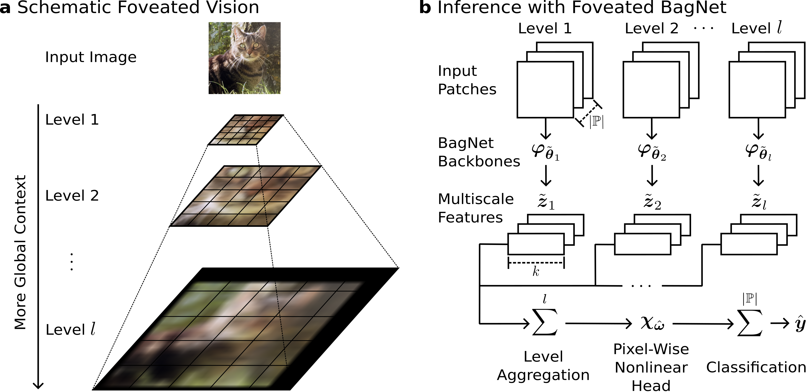

# Foveated BagNet: Inherent Interpretability Does Not Exclude Global Context

This repository implements Foveated BagNets and provides tools for their training and evaluation.



## Installation

Requires Python >= 3.14 (see `pyproject.toml`).

We use `uv` for setting up the environment, since the included `uv.lock` file pins exact
package versions and guarantees a reproducible install:

```bash
# Install uv if you don't already have it: https://docs.astral.sh/uv/getting-started/installation/
uv sync
```

## Training
```bash
python train.py --cfg path/to/config.yaml --data/path_to_image_root path/to/images
```
The code utilizes the standard `torchvision.datasets.ImageNet` loader.
Please structure your ImageNet directory as follows:
```text
path/to/images <-- Also definable in config.yaml
├── train/
│   ├── n01440764/...
│   ├── ...
│   └── n15075141/...
├── val/
│   ├── n01440764/...
│   ├── ...
│   └── n15075141/...
└── ILSVRC2012_devkit_t12.tar.gz <-- REQUIRED by torchvision
```
The training script will create a directory structure containing hyperparameters and model checkpoints:
```text
version_N
├── checkpoints/
│   ├── epoch=0.ckpt
│   ├── epoch=1.ckpt
│   └── ...
└── hparams.yaml
```

### Resume from Checkpoint
To resume the training from a given checkpoint run:
```bash
python resume.py --ckpt path/to/checkpoints/epoch=1.ckpt
```
Note that the file hparams.yaml is required to be present in the parent directory of path/to/checkpoints aka path/to.

## Evaluation
### ImageNet-S Masks
To evaluate a model checkpoint on the ImageNet-S 919 object masks run:
```bash
python evaluate.py --ckpt path/to/checkpoint.ckpt --path_to_annotations_root path/to/mask/annotations
```
The evaluation code assumes the ImageNet-S 919 object mask annotations in the following structure:
```text
path/to/mask/annotations
├── validation-segmentation/ <-- ImageNet-S object mask annotations
│   ├── n01440764/...
│   ├── ...
│   └── n15075141/...
└── ImageNetS_im919_mapping_validation.txt
```
We provide a script to download the ImageNet-S annotations automatically.
```bash
sh utils/DownloadImageNetS919.sh some/path
```
Running the script will create a folder ImageNetS919 at some/path containing the object masks as described above and path/to/mask/annotations becomes some/path/ImageNetS919.

### ImageNet Bounding-Boxes
Alternatively, it is possible to evaluate a model checkpoint on the ImageNet bounding box annotations:
```bash
python evaluate.py --ckpt path/to/checkpoint.ckpt --evaluate_on_masks False --path_to_annotations_root path/to/bbox/annotations
```
The bounding box annotations are assumed to match the following directory structure:
```text
path/to/bbox/annotations
└── val <-- ImageNet object bbox annotations
    ├── ILSVRC2012_val_00000001.xml
    ├── ...
    └── ILSVRC2012_val_00050000.xml

```

## License
This repository is licensed under the MIT License; see the [LICENSE](LICENSE) file for details.